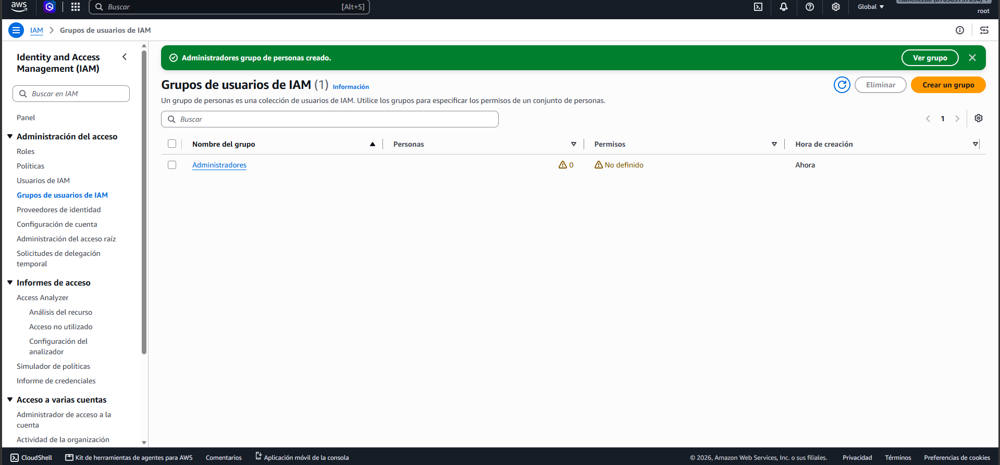
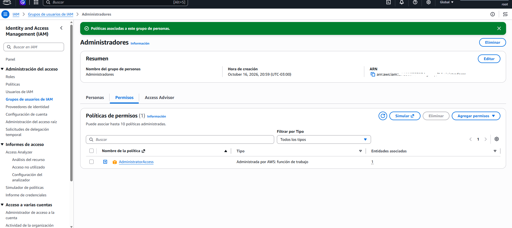

# Laboratorio IAM

## Objetivo

Aprender cómo funciona AWS Identity and Access Management (IAM) y comprender cómo AWS controla el acceso a los recursos mediante usuarios, grupos, roles y políticas.

---

## Servicios Utilizados

- IAM

---

## Actividades Realizadas

- Crear usuario IAM
- Crear grupo IAM
- Crear políticas IAM
- Asignar permisos
- Probar acceso al panel de AWS

---

## Conceptos Aprendidos

- Usuarios IAM
- Grupos IAM
- Políticas IAM
- Roles IAM
- Principio de mínimo privilegio

---

## Conocimientos para AWS Cloud Practitioner

- Gestión de identidades y accesos
- Control de permisos
- Seguridad en AWS
- Usuarios y grupos
- Políticas de acceso
- Autenticación y autorización

---

## Capturas

Las capturas de pantalla de este laboratorio se encuentran en la carpeta `screenshots`.

---

## Reflexión Personal

En este laboratorio aprendí cómo AWS gestiona el acceso a los recursos mediante IAM.

Comprendí la importancia de otorgar únicamente los permisos necesarios a cada usuario siguiendo el principio de mínimo privilegio, uno de los conceptos fundamentales de seguridad en la nube.

---

## Estado del Laboratorio

🟡 En progreso

---

## Avances Realizados

- Limpieza de usuarios y grupos de pruebas anteriores.
- Se mantuvo únicamente el usuario administrativo principal: admin-franz.
- Preparación del entorno para realizar el laboratorio IAM desde cero.
- Creación del grupo IAM "Administradores".
- Verificación de que el grupo fue creado inicialmente sin usuarios ni permisos asignados.

### Creación de un Grupo IAM

Se creó el grupo "Administradores" para comprender cómo AWS permite administrar permisos de manera centralizada.

Inicialmente el grupo fue creado sin usuarios ni políticas asociadas para entender la diferencia entre grupos y permisos.

### Evidencia

### Asignación de Política al Grupo IAM

Se asignó la política administrada por AWS denominada `AdministratorAccess`
al grupo `Administradores`.

Esta política proporciona acceso completo a los recursos de AWS y permite
comprender cómo los permisos son heredados por los usuarios pertenecientes a un grupo.

### Evidencia

