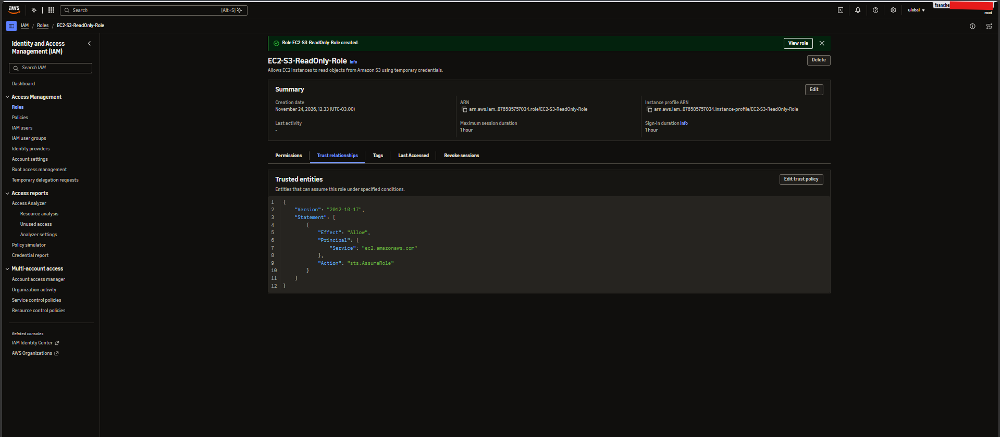

## Laboratorio 02: IAM Roles y STS

### Qué aprendí
- Usar un **IAM Role** (con *instance profile*) para que una instancia **EC2** acceda a **S3** de forma segura sin guardar *access keys* fijas ni credenciales en el código.
- Configurar la **Trust relationship** para permitir que `ec2.amazonaws.com` ejecute `sts:AssumeRole` y obtenga credenciales temporales.

### Evidencia

### Clave para el examen (SAA-C03)
- **EC2 o Lambda accediendo a S3 o DynamoDB:** usar siempre un **IAM Role** (nunca *access keys* hardcodeadas).
- **Acceso entre cuentas:** rol en la cuenta destino con *trust policy* y `sts:AssumeRole`.

