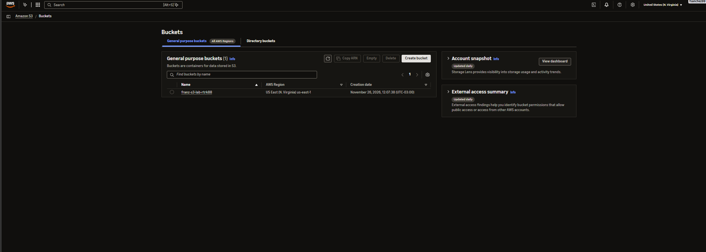
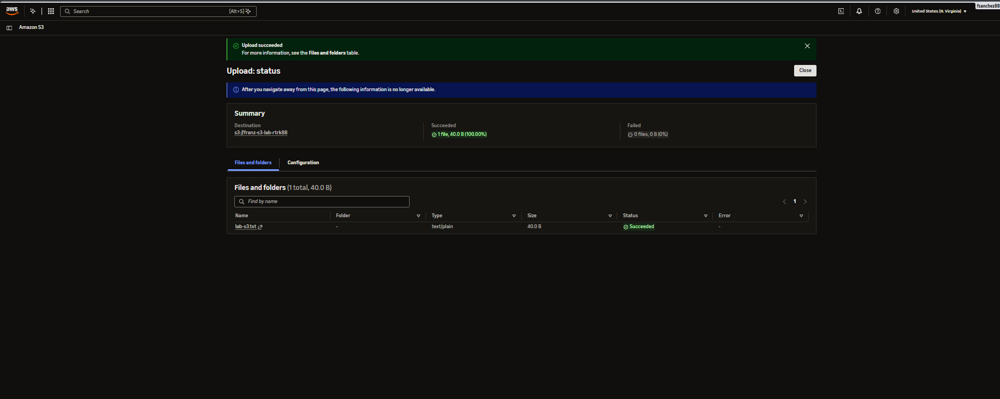
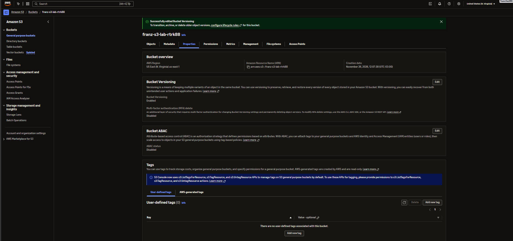
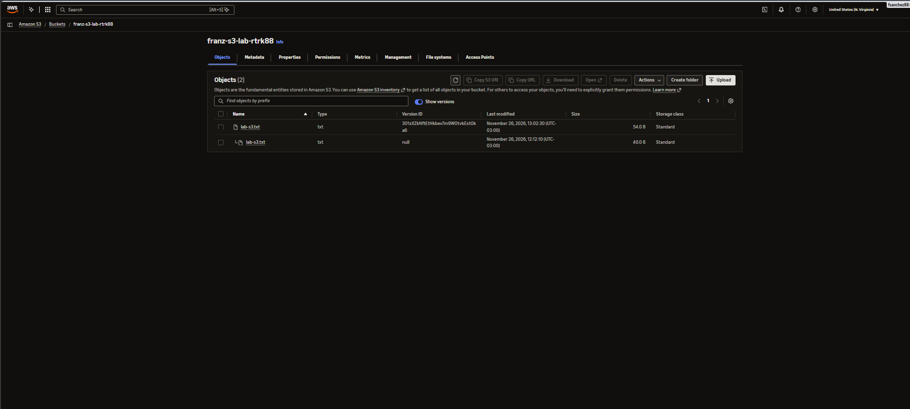
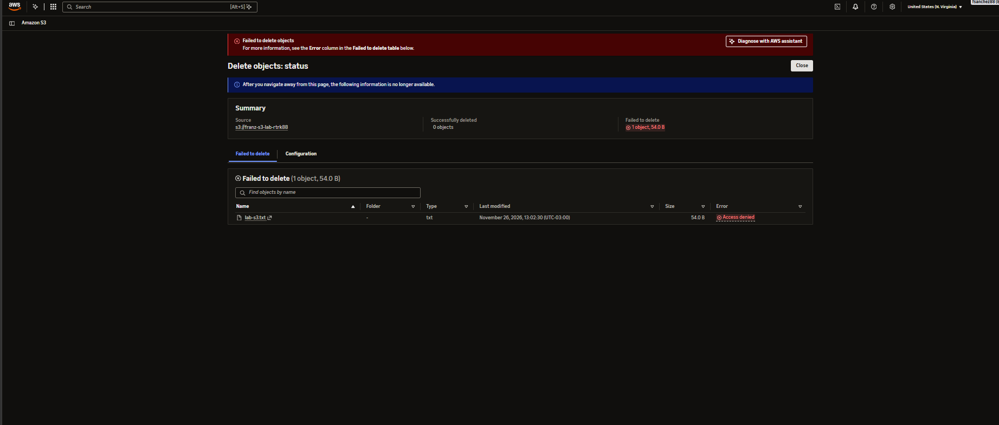

# Laboratorio 03: Amazon S3

## Objetivo

Aprender a crear y administrar buckets de Amazon S3 para almacenar objetos de forma segura utilizando las prácticas recomendadas de AWS.

## Servicios Utilizados

- Amazon S3

## Actividades Realizadas

- Creación de bucket S3.
- Configuración de seguridad mediante Block Public Access.
- Carga de objetos al bucket.
- Validación de almacenamiento de objetos.

## Evidencia

### Bucket creado

### Objeto cargado

## Conceptos Aprendidos

### Amazon S3

Amazon S3 es un servicio de almacenamiento de objetos altamente escalable y duradero.

### Características principales

- Almacenamiento de objetos.
- Servicio regional.
- Durabilidad de 99.999999999% (11 nueves).
- Escalabilidad prácticamente ilimitada.
- Integración con múltiples servicios AWS.

## Diferencias entre servicios de almacenamiento

| Servicio | Tipo |
|-----------|-----------|
| S3 | Object Storage |
| EBS | Block Storage |
| EFS | File Storage |

## Casos de Uso

- Backups.
- Almacenamiento de imágenes.
- Logs de aplicaciones.
- Data lakes.
- Hosting de contenido estático.

## Puntos importantes para el examen SAA-C03

- S3 es un servicio regional.
- Los objetos se almacenan redundados entre múltiples Availability Zones.
- S3 utiliza almacenamiento de objetos.
- No puede montarse como disco directamente en EC2 como EBS.

   ## Versioning

Se habilitó Versioning en el bucket para mantener el historial de cambios de los objetos almacenados.

### Versioning habilitado

### Historial de versiones

### Aprendizajes

- Cada objeto recibe un Version ID.
- Las versiones anteriores permanecen disponibles.
- Permite recuperación ante eliminaciones o sobrescrituras accidentales.
- Es una característica ampliamente utilizada para protección de datos.

## Bucket Policy

Se implementó una Bucket Policy para impedir la eliminación de objetos dentro del bucket.

### Política aplicada

- Effect: Deny
- Action: s3:DeleteObject
- Principal: *

### Resultado

Al intentar eliminar un objeto, AWS respondió con Access Denied.

### Evidencia

### Aprendizajes

- Las Bucket Policies se aplican al bucket.
- Un Explicit Deny tiene prioridad sobre cualquier Allow.
- Las políticas permiten implementar controles de seguridad adicionales.

