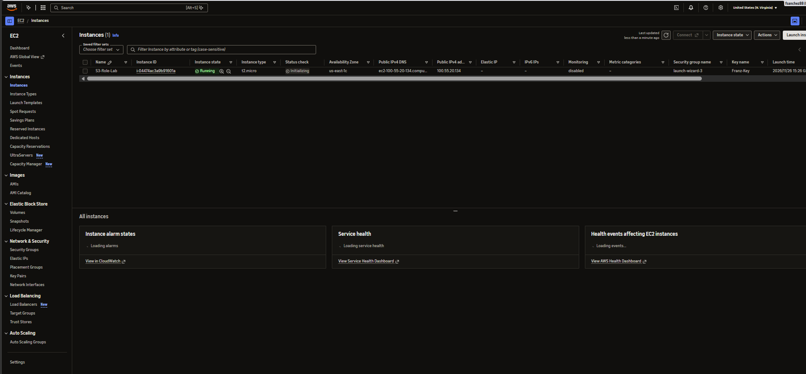

# Acceso a S3 desde EC2 utilizando IAM Role

## Objetivo

Demostrar el acceso seguro desde una instancia Amazon EC2 a un bucket Amazon S3 utilizando un IAM Role, evitando el uso de Access Keys.

## Servicios utilizados

- Amazon EC2
- Amazon S3
- AWS IAM
- AWS STS

## Arquitectura

EC2
↓
IAM Role
↓
Amazon S3

## Actividades realizadas

- Creación de IAM Role para EC2.
- Asignación de permisos de solo lectura sobre Amazon S3.
- Creación de instancia EC2 con Amazon Linux 2023.
- Asociación del IAM Role a la instancia.
- Verificación de identidad mediante AWS STS.
- Acceso a Amazon S3 sin configurar Access Keys.

## Evidencias

### 1. IAM Role creado

El IAM Role fue configurado para permitir que una instancia EC2 acceda a Amazon S3 utilizando credenciales temporales.

---

### 2. Configuración de lanzamiento de EC2

Configuración utilizada antes del despliegue de la instancia EC2.

---

### 3. Instancia EC2 en ejecución

Instancia desplegada correctamente utilizando Amazon Linux 2023.

---

### 4. Verificación de identidad mediante STS

Comprobación de que la instancia asumió correctamente el IAM Role asignado.

---

### 5. Prueba de acceso a S3

Validación del acceso al bucket S3 utilizando las credenciales temporales entregadas por AWS STS.

## Aprendizajes

- Los IAM Roles entregan credenciales temporales mediante AWS STS.
- Las instancias EC2 pueden acceder a servicios AWS sin almacenar Access Keys.
- El uso de IAM Roles mejora la seguridad al evitar credenciales estáticas.
- AmazonS3ReadOnlyAccess permite acceso de solo lectura a los recursos de S3.
- AWS entrega automáticamente credenciales temporales a una instancia EC2 cuando tiene un rol asignado.

## Resultado

La instancia EC2 logró acceder a Amazon S3 utilizando credenciales temporales proporcionadas por AWS STS mediante un IAM Role, demostrando una forma segura y recomendada de autenticación entre servicios dentro de AWS.
