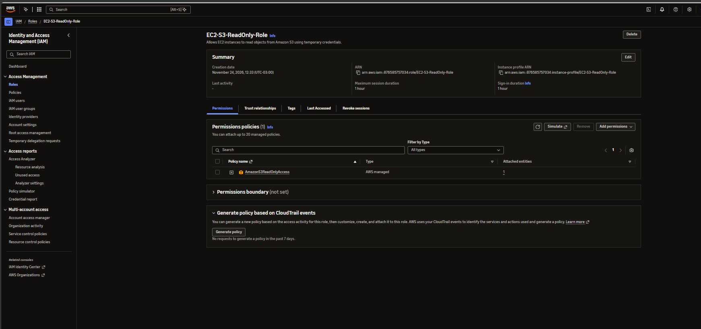
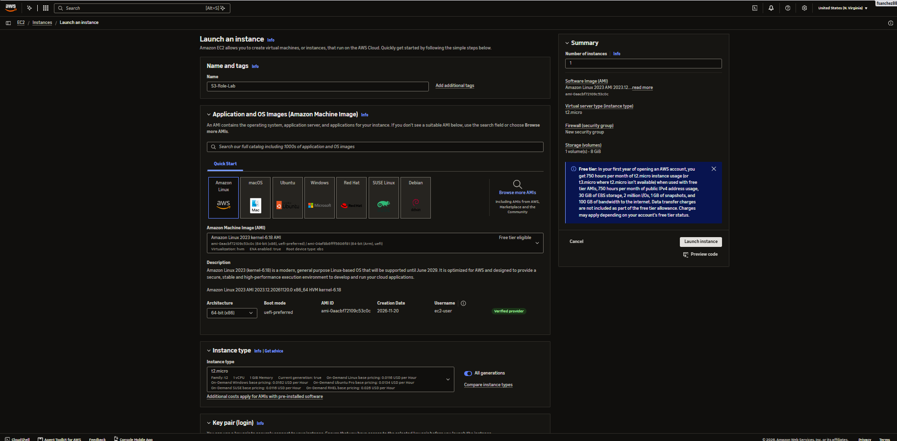
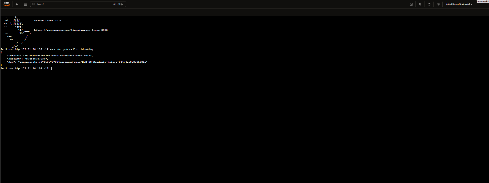
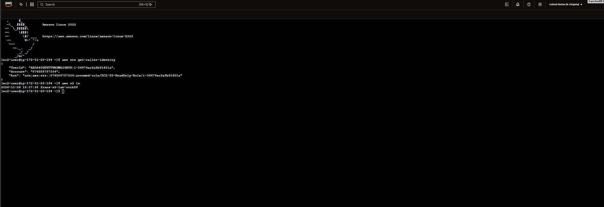

# EC2 Accessing S3 Using IAM Role

## Objective

Demonstrate secure access from an Amazon EC2 instance to an Amazon S3 bucket using an IAM Role instead of AWS Access Keys.

## Services Used

- Amazon EC2
- Amazon S3
- AWS Identity and Access Management (IAM)
- AWS Security Token Service (STS)

## Architecture

EC2 Instance
↓
IAM Role
↓
Amazon S3

## Tasks Performed

- Created an IAM Role for Amazon EC2.
- Attached AmazonS3ReadOnlyAccess permissions.
- Launched an EC2 instance using Amazon Linux 2023.
- Assigned the IAM Role to the EC2 instance.
- Verified the assumed role using AWS STS.
- Accessed Amazon S3 without configuring Access Keys.

## Evidence

### 1. IAM Role Created

The IAM Role was configured for EC2 and granted read-only permissions to Amazon S3.

---

### 2. EC2 Launch Configuration

EC2 instance configuration before deployment.

---

### 3. EC2 Instance Running

Amazon EC2 instance successfully deployed and running.

---

### 4. STS Identity Verification

Verified that the EC2 instance automatically assumed the IAM Role using AWS Security Token Service (STS).

---

### 5. S3 Access Test

Successfully listed S3 resources without using Access Keys.

---

## Key Learnings

- IAM Roles provide temporary credentials through AWS STS.
- EC2 instances can securely access AWS services without storing Access Keys.
- Following AWS security best practices reduces credential exposure risks.
- AmazonS3ReadOnlyAccess grants read-only permissions to Amazon S3 resources.
- AWS automatically provides temporary credentials to EC2 instances through the assigned IAM Role.

## Outcome

The EC2 instance successfully assumed the IAM Role and accessed Amazon S3 using temporary credentials issued by AWS STS, demonstrating a secure and recommended method for service-to-service authentication in AWS.
